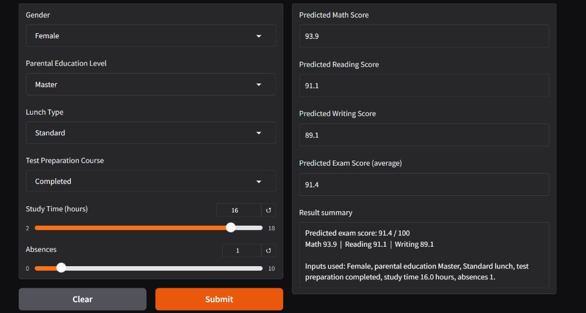
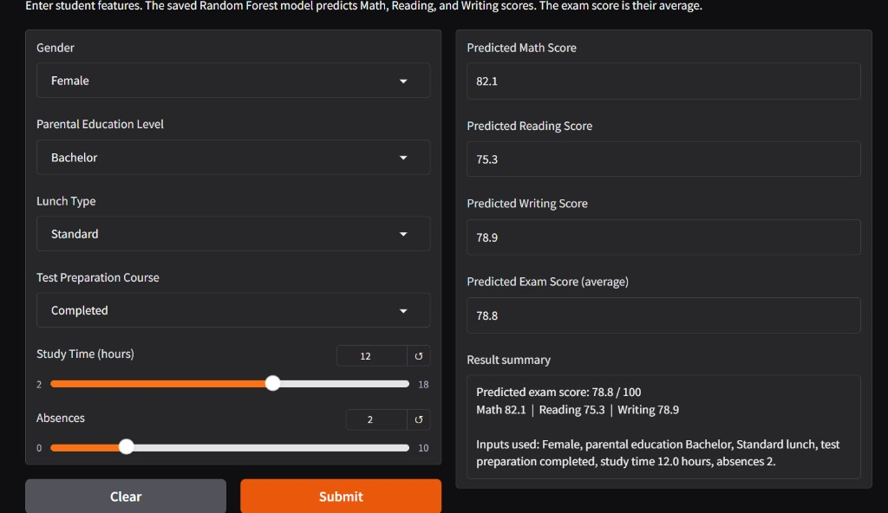
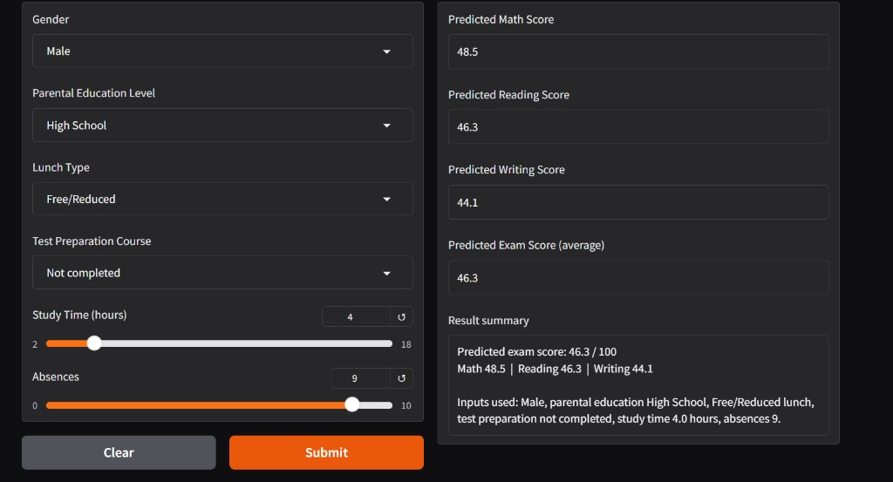

# Student Exam Score Predictor

A local app that predicts a student's exam score from their details, using a trained model and a Gradio interface.

## Summary

A model was trained on student performance data and saved. The app lets a user enter a new student's details and see the predicted score.

The inputs are gender, parental education level, lunch type, whether the test preparation course was completed, study time, and absences. The model predicts three scores: Math, Reading, and Writing. The **exam score** is their average.

## Model

The model is a **Random Forest Regressor** from scikit-learn.

Saved settings:

- Number of trees: 300
- Max depth: 10
- Minimum samples to split: 5
- `random_state`: 42

Before training:

- Missing values in Test Preparation Course were filled with `Not completed`
- Text columns (gender, parental education, lunch type, test preparation) were converted to numbers with a **LabelEncoder**
- Study time and absences were scaled with a **MinMaxScaler**

Saved files in the `models` folder:

| File | Role |
|---|---|
| `best_random_forest_model.joblib` | The trained model |
| `label_encoders.joblib` | Converts text inputs to numbers |
| `min_max_scaler.joblib` | Scales study time and absences |

## How to run

From the project folder:

```powershell
pip install -r requrment.txt
python app.py
```

Then open the browser at:

[http://127.0.0.1:7860](http://127.0.0.1:7860)

Fill in the inputs and press **Submit**.

## Sample results

The same model gives a higher score when study time is high, absences are low, and test preparation is completed. The score drops in the opposite case.

### Strong case — 91.4

Female student, parental education Master, Standard lunch, preparation completed, 16 hours of study, and 1 absence.



### Middle case — 78.8

Female student, parental education Bachelor, Standard lunch, preparation completed, 12 hours of study, and 2 absences.



### Weak case — 46.3

Male student, parental education High School, Free/Reduced lunch, preparation not completed, 4 hours of study, and 9 absences.


